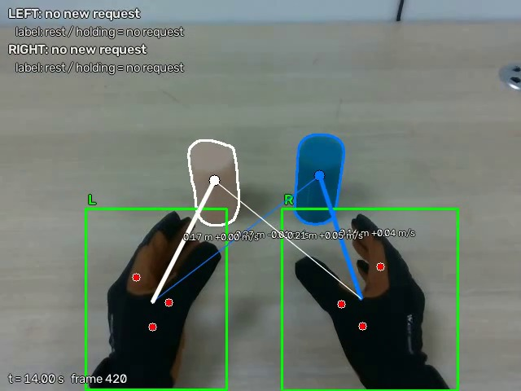

# Soft glove: motion-only perception and control pipeline

An offline Python pipeline for an assistive soft glove. It reads RGB-D recordings of a hand and the objects it touches, estimates per-action cues, turns them into proposals, gates them with a supervisor, drives a simulated glove state machine, and scores the result against annotated ledgers.

The glove itself is a cable-driven soft hand with actuator housings on the wrist. This repository contains the software only. It runs in simulation and offline evaluation, and it does not command the hardware.



Offline replay from the v3 run at 14 seconds: green boxes on both gloved hands, object outlines and hand-object distance lines, and the per-hand decision ("no new request"). The frame is cropped to the video area.

## How it works

1. **Scene geometry.** Per-hand features from 3D hand landmarks and a RANSAC table plane: heights, rates and pairwise distances that do not depend on camera pose.
2. **Contact events.** Onset and offset detection from sensor traces, using a relative-change rule.
3. **Action readouts.** Learned and rule-based readouts for each action, compared under matched parameter budgets and scored per person.
4. **Glove supervisor.** A per-hand finite-state machine with confirmation counts, a cool-down after each command, hold-on-loss, and a veto input. It emits glove commands and a per-tick trace.
5. **Replay and scoring.** Recorded packets are replayed deterministically and scored against annotated ledgers.

## Architecture

| Module | Role |
|---|---|
| `sg_offline/scene.py` | Hand landmarks and scene cues on the table plane |
| `sg_offline/tableplane.py` | RANSAC table-plane fitting |
| `sg_offline/objects.py`, `appearance.py` | Object observations |
| `sg_offline/contact.py` | Contact-event detection |
| `sg_offline/inference.py` | Action readouts and rule-based controls |
| `sg_offline/fsm.py` | Glove supervisor state machine |
| `sg_offline/replay.py` | Deterministic replay of recorded packets |
| `sg_offline/training.py` | Training examples and their provenance |
| `sg_offline/ledger.py` | Annotation ledgers |
| `sg_offline/evaluation.py`, `stats.py`, `experiment.py` | Scoring and comparisons |
| `sg_offline/rgbd.py`, `recordings.py` | Recording manifest schema |

## Command-line tools

| Tool | Purpose |
|---|---|
| `run_perception.py` | Run object and hand perception over a recording |
| `run_rgbd_checks.py`, `run_motion_checks.py` | Synthetic checks of the RGB-D and motion pipelines |
| `replay_packets.py` | Replay recorded packets deterministically |
| `score_requests.py` | Score a session against an annotated request ledger |
| `run_comparison.py` | Compare readout arms on the same data |
| `timed_recording.py` | Display a recording timeline |
| `label_frames.py`, `label_frames_web.py` | Label frames for hand landmarks |
| `d435_recording_adapter.py`, `image_sequence_adapter.py` | Convert RealSense and image-sequence recordings to the manifest format |

## Tests

The suite has about 350 test functions. Most use synthetic fixtures. Some expect recording data that this repository does not include, and the suite was not run for this snapshot.

```bash
python -m pytest
```

## Requirements

- Python 3
- numpy, OpenCV (`cv2`), PyTorch and ultralytics (segmentation)
- pytest for the tests
- pyrealsense2, only for the RealSense D435 adapter

No versions are pinned in this snapshot.

## Status and limits

- This is a snapshot of an earlier architecture, last edited on 16 October 2026. The project's direction has since changed, so this code shows one design, not the current one.
- The software is simulation and offline evaluation only. No hardware interface is called, so the link from the state machine to the rig is not implemented here.
- Recording data, labels and participant data are not included. Scripts that process recordings expect those inputs and will not run as they are.

## Repository layout

| Path | Contents |
|---|---|
| `sg_offline/` | Pipeline package |
| `*.py` at the root | Command-line tools |
| `tests/` | Pytest suite |
| `recording_script*.json` | Recording timelines read by `timed_recording.py` |
| `fsm_still_contact.json` | Example supervisor configuration |
| `rgbd_contract.md` | Recording manifest contract |
| `docs/images/` | Example image used in this README |

## License

MIT. See [LICENSE](LICENSE).
